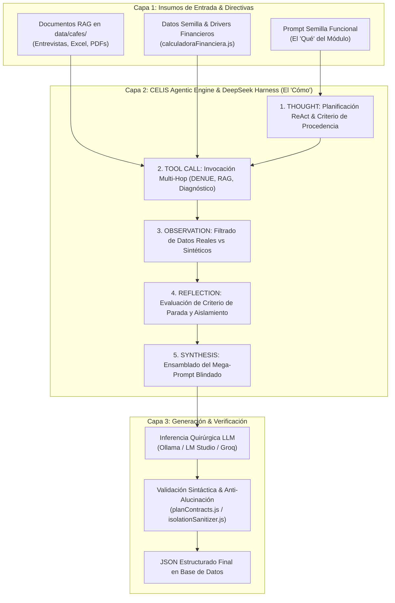

# Arquitectura de Prompts, Motores y Herramientas: Metodología CAFES UNISON y Método Bob 1 UNISON

Este documento define la arquitectura de inteligencia artificial, los prompts especializados, el ecosistema de herramientas y el **pipeline agéntico (DeepSeek Harness + RAG Multi-Hop)** de **Open Business Plan (OBP)** utilizados para generar cada unidad y módulo de la metodología **CAFES UNISON** y del **Método Bob 1 UNISON**, fundamentando la selección técnica de cada componente.

---

## 1. Filosofía de Generación: Determinismo Matemático vs. Inferencia Lingüística

En Open Business Plan, la generación de planes de negocio no delega los cálculos numéricos a la alucinación estocástica de los modelos de lenguaje (LLM). Seguimos el principio de **Backstage-RED**:
- **90% Lógica Determinista:** Motores de cálculo en JavaScript/TypeScript puro (capex, opex, depreciaciones, márgenes, estados proforma, punto de equilibrio y relación B/C).
- **10% Inferencia Quirúrgica de LLM:** Redacción explicativa, contextualización de mercado, narrativa estratégica y alineación pedagógica con el programa de estudios del docente.

---

## 2. Mapa de Herramientas de Open Business Plan: ¿Qué Usamos y Por Qué?

| Herramienta / Módulo OBP | Estado | Función Específica en CAFES | Justificación Técnica ("¿Por qué se usa?") |
| :--- | :--- | :--- | :--- |
| `src/lib/finanzas/calculadoraFinanciera.js` | **Existente (Reutilizada)** | Cálculo de flujos de caja, estados de resultados proforma a 12 meses, balance general y relación Beneficio/Costo (B/C). | Garantiza que las cifras de ventas, costos y utilidades de la Unidad F coincidan exactamente al centavo, eliminando discrepancias matemáticas en la revisión docente. |
| `src/lib/finanzas/driversExtractor.js` | **Existente (Reutilizada)** | Extracción de variables base del proyecto (precio de venta, costo de insumos, capacidad diaria de producción, sueldos). | Permite que si el usuario cambia el precio de un producto en la Unidad B, el cambio se propague de forma reactiva a la Unidad F y a los Anexos sin requerir regenerar manualmente todo el plan. |
| `src/lib/evidenceContext.js` | **Existente (Conexión RAG)** | Constructor de contexto documental RAG que recupera párrafos relevantes y restringe alucinaciones. | Extrae hechos de entrevistas y reportes en `data/cafes/` y los inyecta en el prompt con el badge `⚠️ RESTRICCIÓN Y HECHO INVIOLABLE VALIDADO`. |
| `src/lib/agenticEngine.js` | **Existente (DeepSeek Harness)** | Orquestador agéntico autónomo ReAct con registro de trayectoria DAG y verificación de procedencia. | Transforma las directivas en un proceso cognitivo multi-etapa: Pensamiento ➔ Llamada a Herramienta ➔ Observación Factual ➔ Reflexión Crítica ➔ Síntesis Final. |
| `src/lib/field_guides.js` | **Existente (Enriquecida)** | Inyección de guías de redacción contextuales por campo (`CAFES_UNISON_GUIDES` y `BOB_UNISON_GUIDES`). | Evita que el usuario quede frente a un campo en blanco; cada campo cuenta con instrucciones pedagógicas, ejemplos de microempresas sonorenses, fuentes y citas canónicas. |
| `src/lib/docxExportEngine.js` | **Existente (Adaptada)** | Compilación y renderizado tipográfico a documento formal de Microsoft Word (`.docx`). | Genera la entrega académica final con portada institucional, carta de presentación, tablas financieras formateadas con celdas visibles y expediente de anexos A1 a A22. |
| `data/cafes/inegi/` + `tool_inegi_denue` | **Nueva / Adaptada** | Consulta de microdatos locales (DENUE, Censos Económicos y demografía de Hermosillo y Sonora). | La Unidad B exige cuantificar la demanda en el entorno local. Usar datos de INEGI Sonora grounded evita estimaciones genéricas de otros países o estados. |
| `data/cafes/calculos/` + Parser de Excel | **Nueva (Herramienta Especializada)** | Ingesta directa de la memoria de cálculo en Excel utilizada tradicionalmente en el aula de CAFES. | Los estudiantes y asesores suelen trabajar sus corridas financieras en hojas de cálculo. Este parser permite volcar sus celdas directamente al modelo OBP sin transcripción manual propensa a errores. |
| `data/cafes/entrevistas/` + Ingesta Manual | **Nueva (Flujo Estructurado)** | Formulario interactivo de captura de la entrevista diagnóstica realizada por el asesor de CAFES. | La Unidad A (Módulo 1: Perfil del Emprendedor) no debe ser inventada por la IA; proviene de la entrevista cualitativa directa realizada al emprendedor social. |
| `data/cafes/anexos/` + Gestor de Evidencias | **Nueva (Flujo de Soportes)** | Centralización de constancias oficiales (INE, RFC, cotizaciones, fotos, croquis) para el expediente A1 a A22. | Resguarda y numera los 22 anexos académicos para su inserción automática en la exportación Word. |

---

## 3. El Motor Agéntico Real: DeepSeek Harness & Pipeline RAG Multi-Hop

Los prompts funcionales que se detallan en la Sección 4 **NO se ejecutan como cadenas de texto simples ni aisladas**. En Open Business Plan, la generación se ejecuta a través del **CELIS Agentic Engine (`src/lib/agenticEngine.js`)** respaldado por el **DeepSeek Harness Trajectory Recorder** y el módulo de **RAG de Evidencias (`src/lib/evidenceContext.js`)**.

### 3.1. Arquitectura de Dos Capas: Prompt Semilla vs. Mega-Prompt Agéntico Ensamblado



### 3.2. Las 5 Fases Cognitivas del DeepSeek Harness

1. **Fase 1: THOUGHT (Meta Cognitiva & Planificación ReAct):**
   - El agente analiza el módulo a generar (ej. Unidad B: Estudio de Mercado).
   - Fija la meta: *Validar demanda, identificar competidores y exigir al menos 2 fuentes verificadas*.
   - Registra el nodo en el DAG de trayectorias con marca temporal y parámetros de ejecución.

2. **Fase 2: TOOL CALL (Invocación de RAG y Herramientas Factuales):**
   - **RAG Multi-Hop (`buildEvidenceContext`):** Escanea `config.documents` e ingesta archivos de `data/cafes/`. Extrae los párrafos que coinciden semánticamente con la consulta del módulo.
   - **Prioridad Inmutable:** Si el documento tiene la propiedad `isImmutableConstraint: true` (ejemplo: la entrevista diarizada de Viktor Acuña donde se declara un CAPEX máximo de $150,000 MXN y el rechazo estricto a mesas/sillas; o el costeo de $10.44/galleta de Raúl), el motor le asigna el encabezado:
     `⚠️ RESTRICCIÓN Y HECHO INVIOLABLE VALIDADO: [Nombre Documento]`
   - **Herramienta Geográfica:** Invoca `tool_inegi_denue` para Hermosillo/Sonora, trayendo negocios reales con nombre comercial, coordenadas y actividad SCIAN formal.
   - **Herramienta Financiera:** Invoca `calculadoraFinanciera.js` para extraer el Punto de Equilibrio y la Relación B/C ya calculados deterministamente.

3. **Fase 3: OBSERVATION (Resguardo de Procedencia):**
   - El Harness clasifica la evidencia obtenida:
     - Si hay datos de DENUE o internet real: Marca `provenance: 'real'`.
     - Si no hay datos oficiales: Marca `provenance: 'none'` e inyecta la directiva:
       *"PROHIBIDO inventar competidores o cifras ficticias; declara explícitamente la limitación informativa local"*.

4. **Fase 4: REFLECTION (Evaluación Crítica & Aislamiento):**
   - El crítico del Harness verifica que no exista contaminación cruzada de otros proyectos del workspace (aislamiento garantizado por `isolationSanitizer`).
   - Confirma si se cumplió el umbral de fuentes verificadas antes de permitir el paso a la redacción.

5. **Fase 5: SYNTHESIS (El Mega-Prompt Ensamblado en Producción):**
   El LLM recibe un prompt compuesto por múltiples capas de contexto de hasta 65,000 tokens:
   - **Rol Global:** Asesor Senior de CAFES UNISON / Metodología Bob 1.
   - **Directiva de Ubicación Estricta:** Regla inquebrantable de localidad (ej. Hermosillo, Sonora).
   - **Evidencia RAG del Proyecto:** Párrafos exactos de la entrevista cualitativa o reporte de costos.
   - **Datos Observados por Herramientas:** Lista de establecimientos DENUE y memoria financiera determinista.
   - **Contrato de Verbosidad:** Restricción de longitud y estilo adaptativo (`conciso`, `normal`, `detallado`).
   - **Contrato de Formato:** Esquema estricto de claves JSON sin markdown externo ni comentarios sueltos.

### 3.3. Plantilla del Mega-Prompt Agéntico Ensamblado (Código Real en `agenticEngine.js`)

```markdown
Eres el Agente Autónomo Especialista en "{title}" de Open Business Plan (Fondo Thoth AC / CAFES UNISON).
Debes redactar contenido ejecutivo proporcional al tipo y escala real del proyecto.

REGLA ESTRICTA DE UBICACIÓN:
El negocio opera o tiene cobertura en "{location}". NO inventes ciudades ni asumas capitales ajenas. Respeta estrictamente esta ubicación.

DIRECTIVA ESTRICTA DE PROCEDENCIA DE DATOS:
- Nivel de Procedencia Detectado: {agentGoal.provenanceLevel}
- Si las fuentes provienen de internet verificada o DENUE, cita los datos, nombres y rangos observados fielmente.
- Si no hay fuentes reales verificadas (provenance === 'none'), NO inventes nombres de competidores ficticios como si fueran reales; declara la limitación informativa explícitamente.

RESTRICCIÓN DE LONGITUD Y VERBOSIDAD:
{verbosityDirective}

EVIDENCIA RECUPERADA DEL PROYECTO (RAG MULTI-HOP):
⚠️ RESTRICCIÓN Y HECHO INVIOLABLE VALIDADO: {doc.name}
{párrafos_relevantes_de_la_entrevista_o_memoria_de_calculo}
---

DATOS OBSERVADOS POR HERRAMIENTAS EN TIEMPO REAL:
- Directorio DENUE Oficial: {datos_inegi_verificados}
- Memoria de Cálculo Financiera (Determinista): {metricas_financieras_validadas}
- Diagnóstico Atómico (si aplica): {diagnostico_cuantico}

CONTEXTO DETALLADO DEL PROYECTO (SEMILLA):
- Nombre del Proyecto: {queryGiro}
- Cobertura / Ubicación: {location}
- Problema / Necesidad detectada: {problemDesc}
- Solución / Propuesta de Valor: {solutionDesc}
- Mercado Objetivo / Cliente Ideal: {targetMarket}
- Modelo de Ingresos: {revenueModel}
- Ventaja Competitiva: {unfairAdvantage}

CAMPOS REQUERIDOS (Devuelve ÚNICAMENTE un JSON válido con estas claves exactas):
{fields.map(f => `"${f.key}": "${f.label} - ${guia_de_campo}"`)}

CONTRATO DE CONFIABILIDAD Y AISLAMIENTO:
- Queda terminantemente prohibido mezclar información de empresas ajenas.
- Las cifras numéricas deben coincidir al 100% con la Memoria de Cálculo Financiera suministrada arriba.
```

---

## 4. Catálogo Canónico de Prompts por Unidad y Módulo (CAFES UNISON)

A continuación se listan las **Semillas Directivas (User Prompts)** que el Harness inyecta en la Fase 5 de Síntesis para cada uno de los 15 módulos académicos:

### Rol Global del Sistema (System Prompt Base)
```markdown
Eres el Asesor Senior de Emprendimiento Social y Modelación de Negocios del Centro de Asesoría Financiera y Emprendimiento Social (CAFES) del Departamento de Economía de la Universidad de Sonora (UNISON), coordinado con el programa SAETA TAP.
Tu misión es formular y estructurar un Plan de Negocios riguroso, pedagógico, realista y de alta viabilidad para microempresas familiares, oficios y proyectos de autoempleo en el estado de Sonora.
Reglas fundamentales:
1. Respetar estrictamente la nomenclatura, incisos y directrices académicas de las 9 Unidades (Unidad A a Unidad I) y 15 Módulos del índice oficial.
2. Basarte estrictamente en los drivers del proyecto, la memoria de cálculo financiero y las respuestas de la entrevista diagnóstica sin inventar cifras fantasiosas.
3. Utilizar un lenguaje profesional, claro, empático y estructurado en español neutro premium, adecuado tanto para evaluación académica universitaria como para solicitud de capital semilla o microcréditos.
```

---

### Unidad A: Fundamentos del Negocio

#### Módulo 0: Resumen Ejecutivo (Incisos 0.1 al 0.14)
- **Herramientas del Harness:** `driversExtractor.js`, `calculadoraFinanciera.js`, `evidenceContext.js`.
- **RAG Vinculado:** Extrae la síntesis de todos los módulos ya completados del plan.
- **Prompt Semilla:**
```markdown
Genera el Módulo 0 (Resumen Ejecutivo) del plan de negocios para {nombre_proyecto}, sintetizando con máxima claridad los 14 incisos requeridos:
0.1 Descripción del negocio y situación actual.
0.2 Problema/oportunidad que atiende en su comunidad.
0.3 Propuesta de valor central (diferenciadores clave).
0.4 Perfil del cliente objetivo.
0.5 Tamaño y validación de la demanda inicial.
0.6 Competencia directa local y ventaja competitiva.
0.7 Modelo de ingresos y política de precios.
0.8 Requerimiento de capital semilla, inversión inicial y desglose esencial.
0.9 Proyección de ventas y utilidad neta esperada en el Año 1 (basado en drivers: {drivers_financieros}).
0.10 Punto de equilibrio en unidades y pesos mensuales.
0.11 Relación Beneficio/Costo (B/C).
0.12 Impacto social y familiar esperado (autoempleo, calidad de vida).
0.13 Principales riesgos detectados y plan de contingencia inmediato.
0.14 Cronograma de implementación general (hoja de ruta de 12 semanas).
```

#### Módulo 1: Perfil del Emprendedor y del Proyecto (Incisos 1.1 al 1.6)
- **Herramientas del Harness:** Ingesta RAG desde `data/cafes/entrevistas/`.
- **RAG Vinculado:** Párrafos de la entrevista presencial realizada por el docente o consultor.
- **Prompt Semilla:**
```markdown
A partir de los datos recabados en la entrevista inicial ({datos_entrevista_emprendedor}), redacta de forma estructurada el Módulo 1 (Perfil del Emprendedor y del Proyecto):
1.1 Datos de identificación del emprendedor y del núcleo familiar participante.
1.2 Historia, motivación personal y nivel de compromiso con la iniciativa.
1.3 Experiencia técnica en el oficio y habilidades laborales previas.
1.4 Horario disponible y esquema de apoyo familiar (dedicación exclusiva o combinada).
1.5 Diagnóstico de necesidades de capacitación técnica y administrativa.
1.6 Situación operativa actual del negocio (clientes activos, ventas históricas y productos comercializados).
```

---

### Unidad B: Mercado y Cliente

#### Módulo 2: Idea de Negocio y Portafolio de Productos/Servicios (Incisos 2.1 al 2.5)
- **Herramientas del Harness:** `evidenceContext.js` (hojas de costos de insumos y fichas técnicas).
- **Prompt Semilla:**
```markdown
Desarrolla el Módulo 2 (Idea de Negocio y Portafolio) para {nombre_proyecto}:
2.1 Descripción detallada del bien o servicio central ofrecido.
2.2 Catálogo estructurado de productos/servicios con sus especificaciones y presentaciones.
2.3 Necesidad específica que satisface y beneficios para el consumidor.
2.4 Factores innovadores o diferenciales respecto a las soluciones tradicionales existentes.
2.5 Ficha técnica esencial por producto y Lista de Materiales por Lote (BOM - Bill of Materials).
```

#### Módulo 3: Estudio de Mercado Práctico (Incisos 3.1 al 3.8)
- **Herramientas del Harness:** `tool_inegi_denue` (Sonora/Hermosillo) + `tool_web_search`.
- **RAG Vinculado:** Directorio DENUE con coordenadas y microdatos de colonias.
- **Prompt Semilla:**
```markdown
Elabora el Estudio de Mercado Práctico (Módulo 3) fundamentado en microdatos de {cobertura}:
3.1 Definición y segmentación del mercado objetivo (perfil sociodemográfico y hábitos locales).
3.2 Estimación de la demanda aparente y frecuencia de consumo local.
3.3 Mapeo y análisis de la competencia directa e indirecta (precios, calidad y ubicación).
3.4 Identificación y selección de proveedores locales clave de insumos y materias primas.
3.5 Determinación y justificación del precio de venta y condiciones de cobro.
3.6 Canales de comercialización y distribución más convenientes.
3.7 Estrategias prácticas de promoción y publicidad comunitaria de bajo costo.
3.8 Plan comercial inicial para los primeros 90 días de operación.
```

---

### Unidad C: Propuesta de Valor y Operaciones

#### Módulo 4: Plan de Operaciones y Producción (Incisos 4.1 al 4.10)
- **Herramientas del Harness:** `evidenceContext.js` + simulador de capacidad instalada.
- **Prompt Semilla:**
```markdown
Estructura el Plan de Operaciones y Producción (Módulo 4) de {nombre_proyecto}:
4.1 Descripción paso a paso del proceso productivo o de prestación del servicio.
4.2 Diagrama de flujo del proceso con tiempos estándar por fase.
4.3 Determinación de la capacidad instalada y de la capacidad real esperada (por día/semana/mes).
4.4 Distribución espacial del área de trabajo (Layout / croquis funcional del taller o local).
4.5 Requerimiento pormenorizado de maquinaria, equipo, mobiliario y herramientas.
4.6 Programa de abasto y compras de materias primas e insumos (volúmenes, frecuencia y proveedores).
4.7 Control de inventarios y política de mermas.
4.8 Procedimientos de control de calidad y normas de higiene/seguridad laboral.
4.9 Medidas de seguridad e higiene aplicables al giro.
4.10 Manejo responsable de residuos y sustentabilidad operativa.
```

---

### Unidad D: Legal y Organización

#### Módulo 5: Aspectos Legales y Regulatorios (Incisos 5.1 al 5.5)
- **Prompt Semilla:**
```markdown
Define el marco legal y regulatorio del negocio (Módulo 5):
5.1 Selección y justificación de la figura jurídica recomendada (ej. Persona Física RESICO vs. cooperativa/sociedad).
5.2 Trámites requeridos para la formalización fiscal (SAT, e.firma, alta en padrón de contribuyentes).
5.3 Permisos, licencias municipales y vistos buenos necesarios en el municipio de {cobertura}.
5.4 Obligaciones fiscales periódicas (declaraciones, facturación electrónica CFDI).
5.5 Registro de marca comercial ante el IMPI y protección básica de activos.
```

#### Módulo 6: Organización y Talento Humano (Incisos 6.1 al 6.5)
- **Prompt Semilla:**
```markdown
Diseña la estructura organizativa de {nombre_proyecto} (Módulo 6):
6.1 Estructura organizativa inicial (organigrama funcional adaptado a microempresa/oficio).
6.2 Perfil de puestos y descripción clara de responsabilidades operativas y administrativas.
6.3 Jornadas de trabajo, horarios de producción y esquema de conciliación con la vida familiar.
6.4 Política de remuneración, asignación de sueldo al emprendedor y prestaciones.
6.5 Plan de capacitación inicial en habilidades técnicas y de gestión empresarial.
```

#### Módulo 7: Propuesta de Valor y Modelo de Negocio (Incisos 7.1 al 7.5)
- **Prompt Semilla:**
```markdown
Sintetiza la Propuesta de Valor y el Modelo de Negocio en el Lienzo Canvas (Módulo 7):
7.1 Declaración formal de la propuesta de valor (qué problema resuelve y por qué elegirnos).
7.2 Segmentos de clientes atendidos y relación establecida con ellos.
7.3 Fuentes de ingresos y mecanismos de monetización.
7.4 Recursos y actividades clave para la entrega de valor.
7.5 Red de socios estratégicos y estructura de costos consolidada.
```

---

### Unidad E: Marketing y Comercialización

#### Módulo 8: Plan Comercial (Incisos 8.1 al 8.8)
- **Prompt Semilla:**
```markdown
Formula el Plan Comercial y de Marketing (Módulo 8) para {nombre_proyecto}:
8.1 Estrategia de producto: presentación, marca, empaque y etiquetado con identidad sonorense.
8.2 Estrategia de precios: estructura de costo unitario + margen justo y comparativa frente al mercado.
8.3 Estrategia de plaza/distribución: puntos de venta físicos, venta a domicilio y alianzas con comercios locales.
8.4 Estrategia de promoción: difusión de boca en boca, volantes comunitarios y presencia en redes sociales locales.
8.5 Guion de ventas básico para la atención de clientes y protocolo de servicio.
8.6 Proceso de cotización, cierre de ventas y política de garantías/devoluciones.
8.7 Estrategias de retención y fidelización de clientes recurrentes.
8.8 Presupuesto de comercialización y metas de venta cuantitativas mensuales.
```

---

### Unidad F: Finanzas y Factibilidad

#### Módulo 9: Plan Financiero Integral (Incisos 9.1 al 9.16)
- **Herramientas del Harness:** `calculadoraFinanciera.js` + `data/cafes/calculos/` (Excel de CAFES).
- **RAG Vinculado:** Celdas de la memoria de cálculo del alumno o consultor.
- **Prompt Semilla:**
```markdown
Elabora el Plan Financiero (Módulo 9) utilizando los resultados de la corrida matemática determinista:
9.1 Premisas y supuestos macroeconómicos y operativos del modelo (inflación, días laborales, horizonte).
9.2 Presupuesto analítico de inversión inicial requerida (activo fijo, diferido y capital de trabajo).
9.3 Estructura de financiamiento: aportación propia vs. monto solicitado a financiamiento o capital semilla.
9.4 Desglose de costos fijos mensuales (servicios, mantenimiento, sueldo de autoempleo).
9.5 Determinación del costo variable unitario por producto (mano de obra directa e insumos del BOM).
9.6 Política de precios y proyección de ingresos mensuales a 12 meses.
9.7 Presupuesto de egresos operativos y de administración proyectados.
9.8 Determinación del Capital de Trabajo necesario para el ciclo de caja.
9.9 Estado de Resultados Proforma (a 12 meses y 3 años con EBITDA y utilidad neta).
9.10 Flujo de Efectivo Proyectado mensual verificando saldo final positivo y liquidez constante.
9.11 Balance General Proforma inicial y al cierre del primer año.
9.12 Cálculo del Punto de Equilibrio en unidades físicas y en ingresos monetarios.
9.13 Relación Beneficio/Costo (B/C) formal para programas sociales y de fomento al autoempleo.
9.14 Periodo de Recuperación de la Inversión (Payback simple y descontado).
9.15 Análisis de sensibilidad ante escenarios pesimistas (-15% en ventas o +10% en costos de insumos).
9.16 Conclusiones de factibilidad financiera y sostenibilidad del negocio.
```

---

### Unidad G: Impacto y Gestión de Riesgos

#### Módulo 10: Impacto Social, Familiar y Ambiental (Incisos 10.1 al 10.5)
- **Prompt Semilla:**
```markdown
Evalúa el Impacto Social, Familiar y Ambiental de {nombre_proyecto} (Módulo 10):
10.1 Generación de empleos directos (autoempleo) y empleos familiares indirectos.
10.2 Incremento estimado en el ingreso disponible del hogar y mejora en el nivel de vida.
10.3 Efectos en el bienestar familiar: conciliación laboral, permanencia en el hogar y seguridad.
10.4 Impacto en la economía de la comunidad y proveeduría local de Hermosillo.
10.5 Prácticas de sustentabilidad ambiental, ahorro de energía, reciclaje y manejo de residuos.
```

#### Módulo 11: Matriz de Riesgos y Mitigación (Incisos 11.1 al 11.4)
- **Prompt Semilla:**
```markdown
Elabora la Matriz de Riesgos y Mitigación (Módulo 11):
11.1 Identificación de riesgos operativos (fallas de equipo, interrupción de servicios, mermas).
11.2 Identificación de riesgos de mercado y competencia (caída estacional de demanda, guerras de precios).
11.3 Identificación de riesgos financieros (alzas imprevistas de materias primas, morosidad de clientes).
11.4 Plan de contingencia, acciones preventivas y medidas de mitigación inmediatas por cada riesgo.
```

---

### Unidad H: Implementación y Solicitud al Financiador

#### Módulo 12: Plan de Implementación (Incisos 12.1 al 12.4)
- **Prompt Semilla:**
```markdown
Estructura el Plan de Implementación operativa de {nombre_proyecto}:
12.1 Diagrama de ruta crítica y cronograma de actividades desglosado en un horizonte de 12 semanas.
12.2 Definición de hitos clave de avance y entregables verificables por semana.
12.3 Asignación de responsables e indicadores de cumplimiento operativo.
12.4 Plan de ajuste ante retrasos o eventualidades en la habilitación del negocio.
```

#### Módulo 13: Requerimiento de Capital Inicial (Incisos 13.1 al 13.6)
- **Herramientas del Harness:** `calculadoraFinanciera.js` + `data/cafes/anexos/` (Cotizaciones de proveedores).
- **Prompt Semilla:**
```markdown
Formula la solicitud formal de Capital Semilla / Financiamiento para {nombre_proyecto}:
13.1 Monto total de inversión requerida debidamente redondeado y justificado.
13.2 Desglose analítico del destino de los recursos (maquinaria, insumos iniciales, habilitación, capital de trabajo).
13.3 Estructura de coinversión: aportación propia del emprendedor (en efectivo o especie) vs. recurso solicitado.
13.4 Resumen de cotizaciones comerciales de respaldo y fuentes de proveeduría validadas.
13.5 Proyección del impacto del capital semilla: comparativa del negocio 'antes' y 'después' de recibir el recurso.
13.6 Plan transparente de comprobación del gasto, resguardo de facturas y rendición de cuentas al comité evaluador.
```

#### Módulo 14: Conclusiones y Petición Formal (Incisos 14.1 al 14.3)
- **Prompt Semilla:**
```markdown
Redacta las Conclusiones y la Petición Formal de {nombre_proyecto} dirigida al Comité Dictaminador de CAFES UNISON / Financiador:
14.1 Argumentación integral de viabilidad técnica, comercial y económica del plan de negocios.
14.2 Compromisos formales y éticos que asume el emprendedor en el uso del recurso y cumplimiento de metas.
14.3 Requerimientos específicos de mentoría y acompañamiento que solicita al centro universitario durante el primer año.
```

---

### Unidad I: Expediente de Anexos (A1 a A22)
- **Herramientas del Harness:** `docxExportEngine.js` + `data/cafes/anexos/`.
- **Estructura del Checklist y Carátulas:**
  - Carátula de control para cada uno de los 22 anexos (A1 al A22) requeridos en el índice del docente.
  - La herramienta compila los anexos documentales en el Word final garantizando orden numérico y trazabilidad.

---

## 5. Prompts Exclusivos del Método Bob 1 UNISON (`bob_unison`)

En el **Método Bob 1 UNISON**, además de los 15 módulos académicos de CAFES, se activan los siguientes motores agénticos especializados:

1. **Diagnóstico Cuántico Atómico (Modelo de 3 Áreas de Fondo Thoth AC):**
   - Evalúa el perfil del fundador en Finanzas, Operaciones y Administración.
   - Detecta sobrecarga y previene la "fusión atómica".
   - Genera perfil de delegación profesional (perfil para vacante/LinkedIn, rango salarial, responsabilidades).
2. **Ingeniería de Operaciones bajo Teoría de Restricciones (TOC / Eliyahu Goldratt):**
   - Identifica el recurso con capacidad restringida (CCR) y calcula el rendimiento máximo del sistema (*Throughput*).
   - Métricas avanzadas: On-Time Delivery (OTD) y Cash Conversion Cycle (CCC).
3. **Dimensionamiento Cuantitativo de Mercado (TAM, SAM, SOM y Unit Economics):**
   - Cálculo formal de mercado total, disponible y obtenible con microdatos censales de Sonora.
   - Métricas de CAC (Costo de Adquisición de Clientes) y LTV (Valor del Ciclo de Vida del Cliente).
4. **Simulación Financiera Estocástica de Monte Carlo y Reserva de Contingencia:**
   - 1,000 iteraciones sobre variaciones de precios y costos para proyectar la probabilidad de éxito y calcular el Valor Actual Neto (VAN) y la Tasa Interna de Retorno (TIR) estocásticos.
