# Software Design Document (SDD): Metodología Plan de Negocios CAFES (UNISON / SAETA)

## 1. Identificación y Propósito del Sistema

- **Documento:** SDD_METODOLOGIA_CAFES.md
- **Versión:** 1.0.0
- **Fecha:** Octubre 2026
- **Autoría:** Antigravity AI & Equipo Técnico OBP
- **Contexto Institucional:** CAFES-UNISON (Coordinación / Centro de Asesoría Financiera y Emprendimiento Social - Universidad de Sonora) en colaboración con SAETA TAP para el fomento de microempresas, autoempleo y oficios familiares (repostería, piñatas, barbería, alimentos, confección y servicios locales).

El propósito de este documento es especificar la arquitectura, estructura de datos, flujos de integración y reglas de negocio para el marco de trabajo **`cafes` (Plan de Negocios CAFES)** dentro de la plataforma Open Business Plan (OBP v7.0).

---

## 2. Metodologías de Desarrollo Aplicadas (Ciclo DD Integral)

El diseño e implementación de la Metodología CAFES se rige estrictamente por las siguientes disciplinas de ingeniería:

1. **SDD (Software Design Document):** Este documento arquitectónico formal que define modelos, contratos de interfaz y diagramas de flujo.
2. **TDD (Test-Driven Development):** Pruebas unitarias automatizadas (`tests/cafesFramework.test.js`) que validan la existencia, tipado y completitud de todos los pilares, módulos y campos antes de su consumo en componentes de vista.
3. **ATDD (Acceptance Test-Driven Development):** Criterios de aceptación funcionales basados en la rúbrica del docente (`INDICE DE PLAN DE NEGOCIOS 10.2026-2.docx`) y las entidades evaluadoras de capital semilla.
4. **DDD (Domain-Driven Design):** Modelo de dominio centrado en el microemprendimiento popular: `UnidadAcademica`, `PerfilAtomico`, `BOM_Receta`, `PuntoEquilibrio`, `RelacionBC`, `RutaFormalizacion` y `ExpedienteAnexos`.
5. **FDD (Feature-Driven Development):** Entrega estructurada en 5 características esenciales: F1 (Configuración de Framework), F2 (Guías de IA de Campo), F3 (Mapeo de Widgets/Boxes), F4 (Exportación Ejecutiva Word), F5 (Suite TDD de Verificación).
6. **EDD (Event-Driven Development):** Despacho y escucha de eventos reactivos en `PlanContext` para actualización en tiempo real de cálculos financieros y autoguardado.
7. **XP (Extreme Programming):** Estándares estrictos de código completo, sin fragmentaciones, pruebas automatizadas continuas y refactorización orientada a la simplicidad.
8. **RAD (Rapid Application Development):** Aprovechamiento de la biblioteca de componentes interactivos de OBP (`BoxCanvas`, `MonteCarloSimulator`, `QuantumProfileCard`, `FloorPlanDiagram`).
9. **DevOps & SRE:** Pipelines de validación local mediante scripts unificados (`npm test`, `npm run build`, `./git_sync.sh`) y acuerdos de nivel de servicio (SLI/SLO/SLA).
10. **UXDD (UX-Driven Development):** Interfaz amigable en español neutro premium, visualización de badges por área atómica, microcopia clara y empática para usuarios sin formación contable avanzada.
11. **BDD (Behavior-Driven Development):** Especificación de escenarios Dado/Cuando/Entonces para los flujos principales de usuario.
12. **Empresas Cuánticas (Fondo Thoth AC):** Integración nuclear del Modelo Atómico de 3 Áreas (Finanzas, Operativo, Administrativo) para prevenir la saturación y promover la delegación e independencia del fundador.

---

## 3. Modelo Conceptual del Marco CAFES (C-A-F-E-S)

El framework organiza las **9 Unidades del Docente (A a I)** bajo los 5 pilares metodológicos del acrónimo:

```mermaid
flowchart TD
    subgraph MetodologiaCAFES["Metodología Plan de Negocios CAFES"]
        C["C · Comercial & Mercado"]
        A["A · Administrativo & Legal"]
        F["F · Financiero & Factibilidad"]
        E["E · Estratégico & Operativo"]
        S["S · Social, Sostenibilidad & Solicitud"]
    end

    C --> UB["Unidad B: Idea de Negocio, Portafolio & Estudio de Mercado (TAM/SAM/SOM)"]
    C --> UE["Unidad E: Plan Comercial, Marketing & Lanzamiento 90 Días"]
    C --> U7["Módulo 7: Lienzo Canvas (9 Bloques)"]

    A --> UD5["Módulo 5: Aspectos Legales & Formalización Progresiva (RESICO/SAT)"]
    A --> UD6["Módulo 6: Organización, Talento & Carga Patronal"]
    A --> PRE["Preliminares: Carta de Presentación & Declaración de Veracidad"]

    F --> UF["Unidad F: Plan Financiero, Indicadores (B/C, TIR, VAN) & Proforma"]
    F --> SIM["Simulador Financiero & Análisis de Estrés Monte Carlo"]

    E --> UA["Unidad A: Resumen Ejecutivo & Perfil del Emprendedor Cuántico (3 Áreas)"]
    E --> UC["Unidad C: Operaciones, Cuello de Botella (TOC) & Layout"]

    S --> UG["Unidad G: Impacto Social, Familiar, Ambiental & Matriz de Riesgos"]
    S --> UH["Unidad H: Plan de Implementación (Gantt 12s) & Solicitud Capital Semilla"]
    S --> UI["Unidad I: Expediente de Anexos (A1-A22) & Checklist de Verificación"]
```

---

## 4. Estructura de Datos (Esquema Canónico)

### Identificador Canónico: `cafes`
- **Nombre:** `Plan de Negocios CAFES (Emprendimiento Social y Familiar)`
- **Total Pilares:** 10 (9 Unidades A a I + Simulador Financiero)
- **Total Módulos:** 15 módulos académicos
- **Total Campos:** 108 campos específicos de negocio con soporte para redacción por IA

### Desglose de Pilares y Módulos:
1. `unidad_a` (Resumen y Perfil del Emprendimiento):
   - `resumen_ejecutivo` (0. Resumen Ejecutivo Integral - 14 campos)
   - `perfil_emprendedor` (1. Perfil del Emprendedor y Diagnóstico Cuántico - 9 campos)
2. `unidad_b` (Mercado, Portafolio y Cliente):
   - `idea_portafolio` (2. Idea de Negocio y Portafolio de Productos - 5 campos)
   - `estudio_mercado` (3. Estudio de Mercado Práctico y Demanda - 8 campos)
3. `unidad_c` (Operaciones, Capacidad y Producción):
   - `plan_operaciones` (4. Plan de Operaciones, Cuello de Botella y Layout - 10 campos)
4. `unidad_d` (Legal, Organización y Modelo Canvas):
   - `aspectos_legales` (5. Aspectos Legales y Formalización Gradual - 5 campos)
   - `organizacion_talento` (6. Organización, Talento y Modelo Atómico - 5 campos)
   - `propuesta_valor_canvas` (7. Propuesta de Valor y Lienzo Canvas - 5 campos)
5. `unidad_e` (Marketing y Plan Comercial):
   - `plan_comercial` (8. Plan Comercial, Canales y Lanzamiento 90 Días - 8 campos)
6. `unidad_f` (Finanzas, Factibilidad y Corridas):
   - `plan_financiero` (9. Plan Financiero, Proyecciones y Rentabilidad - 16 campos)
7. `unidad_g` (Impacto Social, Familiar y Gestión de Riesgos):
   - `impacto_social_ambiental` (10. Impacto Social, Familiar y Ambiental - 5 campos)
   - `matriz_riesgos` (11. Matriz de Riesgos y Plan B - 4 campos)
8. `unidad_h` (Implementación y Solicitud al Financiador):
   - `plan_implementacion` (12. Plan de Implementación / Gantt 12 Semanas - 4 campos)
   - `requerimiento_capital` (13. Requerimiento de Capital Semilla e Inversión - 6 campos)
   - `conclusiones_peticion` (14. Conclusiones y Petición Formal de Recursos - 3 campos)
9. `unidad_i` (Anexos y Expediente de Verificación):
   - `expediente_anexos` (Anexos A1 a A22 y Checklist de Control - 23 campos)
10. `simulador_financiero` (Simulador Financiero y Corridas):
   - `simulador` (Simulador Financiero y Escenarios Monte Carlo - 1 campo)

---

## 5. Criterios de Aceptación (ATDD) y Comportamiento Esperado (BDD)

### Escenario 1: Creación y Selección de Proyecto CAFES
- **Dado** que un estudiante o asesor abre el selector de metodologías de OBP,
- **Cuando** selecciona la opción "Plan CAFES (UNISON)",
- **Entonces** la barra lateral debe renderizar de forma correlativa las 9 Unidades (Unidad A a I) más el Simulador Financiero, desplegando los 15 módulos académicos correspondientes.

### Escenario 2: Diagnóstico Cuántico del Emprendedor
- **Dado** que el usuario ingresa a la Unidad A, Módulo 1 (`perfil_emprendedor`),
- **Cuando** revisa el módulo,
- **Entonces** debe contar con campos para el Modelo Atómico de 3 Áreas (Finanzas, Operativo, Administrativo), identificando debilidades del fundador y generando la ruta de delegación e independencia.

### Escenario 3: Cálculo y Justificación de la Demanda (TAM/SAM/SOM)
- **Dado** que el usuario ingresa a la Unidad B, Módulo 3 (`estudio_mercado`),
- **Cuando** solicita la asistencia de la IA o edita el campo `estimacion_demanda_tam_sam_som`,
- **Entonces** el sistema debe estructurar el tamaño del mercado en TAM, SAM y SOM con datos realistas para el municipio o zona de influencia en Sonora/México.

### Escenario 4: Evaluación Financiera con B/C, VAN, TIR y Monte Carlo
- **Dado** que el usuario formula su presupuesto en la Unidad F, Módulo 9 (`plan_financiero`),
- **Cuando** se calculan las proyecciones,
- **Entonces** el sistema debe reportar el Punto de Equilibrio (unidades y pesos), la Relación Beneficio/Costo (B/C > 1.0), el VAN y la TIR considerando la tasa de descuento de oportunidad.

### Escenario 5: Exportación a Microsoft Word (.docx)
- **Dado** un proyecto completo bajo el método `cafes`,
- **Cuando** el usuario ejecuta la exportación ejecutiva a Word,
- **Entonces** el documento generado debe incluir portada institucional, Carta de Presentación, Declaración de Veracidad, Índice General, las 9 unidades temáticas desglosadas y la lista de control de Anexos (A1-A22).

---

## 6. Métricas SRE (SLI, SLO, SLA)

| Métrica | Definición | Meta (SLO) | Compromiso (SLA) |
| :--- | :--- | :--- | :--- |
| **SLI-1: Latencia de Renderizado** | Tiempo desde la selección de un módulo de CAFES hasta su renderizado completo en el DOM. | P95 < 80ms | P99 < 150ms |
| **SLI-2: Tasa de Error en Exportación** | Porcentaje de documentos exportados a `.docx` exitosamente sin excepciones. | 100% | > 99.8% |
| **SLI-3: Tiempo de Ejecución de Corridas** | Duración del recálculo financiero de 12 meses proforma y punto de equilibrio. | < 50ms | < 120ms |
| **SLI-4: Cobertura de Pruebas Unitarias** | Porcentaje de módulos y campos de CAFES cubiertos por aserciones de prueba en Vitest. | 100% | 100% |
