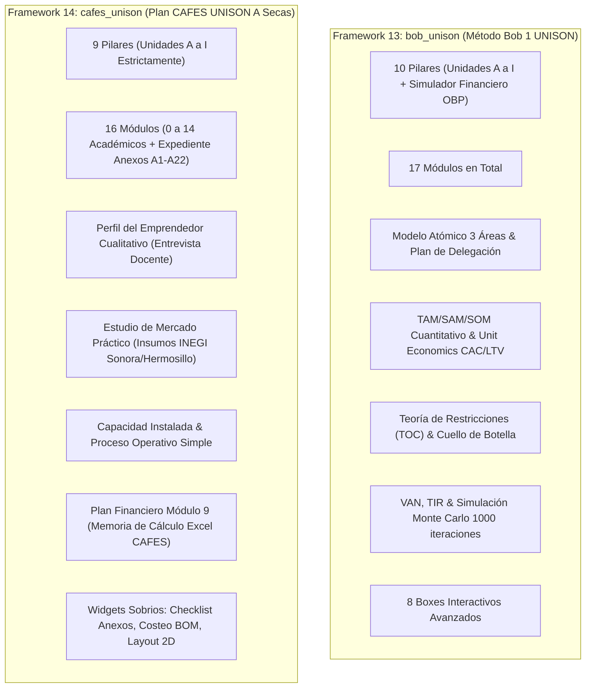

# Software Design Document (SDD): Metodologías UNISON (Método Bob 1 UNISON & Plan CAFES UNISON)

## 1. Identificación y Contexto Institucional

- **Documento:** SDD_METODOLOGIA_CAFES.md
- **Versión:** 2.1.0 (Arquitectura Dual Canónica Integral)
- **Fecha de Actualización:** Octubre 2026
- **Entorno y Autoría:** Antigravity AI & Equipo Técnico OBP
- **Contexto Institucional:** Centro de Asesoría Financiera y Emprendimiento Social (CAFES) — Departamento de Economía, Facultad Interdisciplinaria de Ciencias Económicas y Administrativas, Universidad de Sonora (UNISON), en vinculación con el programa SAETA TAP.
- **Titular y Asesoría Académica:** Dr. Rafael Castillo Esquer / Coordinación CAFES UNISON (Edificio 10L, Campus Hermosillo).
- **Propósito Dual:** Proporcionar en el sistema Open Business Plan (OBP) dos metodologías complementarias de formulación de planes de negocio:
  1. **Framework 13 (`bob_unison`):** "Método Bob 1 UNISON" — Modelo enriquecido que fusiona el rigor académico de UNISON con Open Business Plan (OBP) y la metodología **Empresas Cuánticas (Fondo Thoth AC)**: Modelo Atómico de 3 Áreas (Finanzas, Operativo, Administrativo), ruta de autonomía del fundador, umbrales de escala cuántica, análisis TAM/SAM/SOM, Unit Economics (CAC/LTV), Teoría de Restricciones (TOC) y el pilar interactivo del Simulador Financiero OBP (10 pilares, 17 módulos).
  2. **Framework 14 (`cafes_unison`):** "Plan de Negocios CAFES UNISON" — Modelo académico oficial a secas, 100% fiel al documento original del docente (`INDICE DE PLAN DE NEGOCIOS 10.2026-2.docx`), "ni más, ni menos": exactamente 9 Unidades (Unidad A a I), 15 módulos académicos (0 al 14) + Expediente de Anexos (A1 a A22). Sin pilar extra de simulador OBP (las finanzas se tratan de forma autosuficiente en la Unidad F / Módulo 9 conforme al índice).

---

## 2. Marco Metodológico Canónico (Ciclo DD Integral)

El diseño, implementación y mantenimiento de ambos frameworks se rige por las siguientes disciplinas de ingeniería:

### 2.1. SDD (Software Design Document)
- Especificación formal de la arquitectura de datos, árboles de navegación, modelos jerárquicos y contratos de interfaz.
- Mapeo bidireccional de rutas semánticas (`/planes/metodo-bob/...` y `/planes/plan-cafes/...`).
- Motor de exportación ejecutiva a Microsoft Word (`docxExportEngine.js`) con soporte multi-metodología.

### 2.2. TDD (Test-Driven Development)
- Baterías de pruebas unitarias automatizadas ejecutadas con `node --test`:
  - `tests/bobUnisonFramework.test.js`: 10 pruebas que validan los 10 pilares, 17 módulos, Modelo Atómico y simulador OBP.
  - `tests/cafesFramework.test.js`: 10 pruebas que garantizan la estructura estricta de 9 Unidades A-I, 15 módulos y 22 anexos.
  - `tests/frameworksAndBooksEnrichment.test.js`: 15 pruebas de integridad de los 14 marcos canónicos.
  - `tests/wikiCatalogSync.test.js`: Validación determinista byte a byte del catálogo y páginas generadas.
  - Suite integral del sistema: 519 pruebas pasando sin un solo fallo (`pass 519, fail 0`).

### 2.3. ATDD (Acceptance Test-Driven Development)
- Criterios de aceptación derivados directamente de la rúbrica docente de CAFES UNISON:
  - Criterio 1: Exactitud en la enumeración de módulos (Módulos 0 al 14 respetando subdivisiones decimales 0.1-0.14, 1.1-1.6, etc.).
  - Criterio 2: El módulo `perfil_emprendedor` captura exclusivamente variables cualitativas de autoempleo (sin forzar cálculos algorítmicos complejos no solicitados en la plantilla docente).
  - Criterio 3: El módulo financiero incluye obligatoriamente la Relación Beneficio/Costo (B/C), Punto de Equilibrio y Periodo de Recuperación (Payback).
  - Criterio 4: Exportación limpia a formato Word (.docx) apta para entrega física ante comités de financiamiento solidario.

### 2.4. DDD (Domain-Driven Design)
- Lenguaje ubicuo del dominio de economía social y microemprendimiento:
  - `UnidadAcademica`: Agrupador curricular oficial de CAFES UNISON.
  - `PerfilEmprendedor`: Entidad de caracterización humana y diagnóstico de vulnerabilidad/autoempleo.
  - `PortafolioBOM`: Lista de materiales por lote de producción artesanal.
  - `EstudioMercadoLocal`: Consumo barrial y microdatos georreferenciados (INEGI DENUE Sonora).
  - `MemoriaCalculo`: Estructura contable de ingresos, egresos y punto de equilibrio en hoja de cálculo.
  - `ExpedienteAnexos`: Agregado documental de 22 soportes y constancias (A1 a A22).

### 2.5. FDD (Feature-Driven Development)
- Despliegue guiado por características modulares:
  - Feature 1: Registro formal de `bob_unison` y `cafes_unison` en `FRAMEWORKS`.
  - Feature 2: Ruteo y slugs semánticos en `urlRouting.js`.
  - Feature 3: Identidad visual, iconos (`Sparkles` violeta vs `GraduationCap` azul UNISON) y navegación en `Layout.jsx`.
  - Feature 4: Guías contextuales de IA de campo (`BOB_UNISON_GUIDES` y `CAFES_UNISON_GUIDES`).
  - Feature 5: Box Registry y Module Box Map (5 widgets docentes para CAFES y 8 avanzados para Bob).
  - Feature 6: Motor de exportación Word (.docx) con soporte completo para las 9 Unidades A-I.

### 2.6. EDD (Event-Driven Development)
- Flujo reactivo de eventos desacoplados mediante `PlanContext`:
  - `FIELD_UPDATED`: Disparo de recálculo en cascada al modificar costos de insumos o precios de venta.
  - `CORRIDA_AUTO_CALCULATED`: Sincronización automática de punto de equilibrio y relación B/C.
  - `METHODOLOGY_SWITCHED`: Transición sin pérdida de datos entre `cafes_unison` y `bob_unison`.
  - `AUTOSAVE_TRIGGERED`: Persistencia asíncrona local con control de versiones y copia de seguridad.

### 2.7. XP (Extreme Programming)
- Programación por pares con agentes especializados (Antigravity AI y usuario).
- **Regla Estricta de Código:** Funciones, hooks y componentes entregados SIEMPRE completos de principio a fin, sin recortes ni fragmentos (`// ... resto del código`).
- Refactorización continua orientada a la simplicidad y eliminación de redundancias.
- Integración continua local con validaciones antes de cada commit.

### 2.8. RAD (Rapid Application Development)
- Desarrollo acelerado de componentes reutilizables:
  - `BoxCanvas`: Vista rápida del lienzo de 9 bloques.
  - `ChecklistAnexos`: Gestor de carga y verificación del expediente A1 a A22.
  - `CalculadoraCostosMicro`: Simulador instantáneo de margen bruto y punto de equilibrio por lote.
  - `Layout2D`: Croquis interactivo del taller y distribución de maquinaria.

### 2.9. DEV OPS & Integración Continua
- Ciclo automatizado de build y empaquetado:
  - Compilación de producción con Vite: `npm run build` (< 30 segundos).
  - Generación determinista del catálogo Wiki: `npm run wiki:build`.
  - Sincronización proactiva de repositorio: `./git_sync.sh "mensaje en español"`.
  - Estructuración de carpetas de insumos para ingesta de datos:
    - `data/cafes/entrevistas/`
    - `data/cafes/inegi/`
    - `data/cafes/calculos/`
    - `data/cafes/anexos/`

### 2.10. UXDD (UX-Driven Development)
- Experiencia de usuario empática, clara y accesible para emprendedores familiares:
  - Terminología en español neutro premium, eliminando jerga financiera intimidante ("con peras y manzanas").
  - Identidad institucional respetuosa: Azul UNISON (`#004990`) y acentos de dignidad artesanal (`#d97706`).
  - Navegación fluida por pasos y barras de progreso visual de las 9 Unidades académicas.
  - Tooltips e instrucciones en campo concisas (<= 400 caracteres) y placeholders explicativos (<= 80 caracteres).

### 2.11. BDD (Behavior-Driven Development)
- Escenarios de comportamiento de usuario formalizados en lenguaje Gherkin (Español):

```gherkin
Escenario: Emprendedor consulta su plan bajo el método académico oficial CAFES UNISON
  Dado que el usuario abre un proyecto con metodología "cafes_unison"
  Cuando navega por la barra lateral de módulos
  Entonces visualiza exactamente 9 Unidades identificadas de la A a la I
  Y encuentra 15 módulos académicos numerados del 0 al 14
  Y visualiza el Expediente de Anexos con 22 documentos obligatorios
  Y no se presenta ningún pilar externo de simulador financiero OBP.

Escenario: Emprendedor activa el Método Bob 1 UNISON enriquecido
  Dado que el usuario selecciona el framework "bob_unison"
  Cuando accede al módulo de diagnóstico del fundador
  Entonces el sistema evalúa el Modelo Atómico de 3 Áreas (Finanzas, Operativo, Administrativo)
  Y genera recomendaciones específicas de delegación para prevenir el micromanagement
  Y habilita el pilar interactivo de Simulador Financiero con análisis de sensibilidad Monte Carlo.
```

---

## 3. Arquitectura Comparativa: Framework 13 vs. Framework 14



---

## 4. Estructura Canónica de Módulos (Framework 14: `cafes_unison`)

Siguiendo al 100% el índice del docente (`INDICE DE PLAN DE NEGOCIOS 10.2026-2.docx`):

### Unidad A · Resumen y Perfil
- **0. Resumen Ejecutivo:** Incisos 0.1 al 0.14.
- **1. Perfil del Emprendedor y del Proyecto:** Incisos 1.1 al 1.6 (Entrevista diagnóstica cualitativa).

### Unidad B · Mercado y Cliente
- **2. Idea de Negocio y Portafolio:** Incisos 2.1 al 2.5 (Fichas técnicas y BOM de materiales por lote).
- **3. Estudio de Mercado Práctico:** Incisos 3.1 al 3.8 (Microdatos locales INEGI, competencia y canales).

### Unidad C · Propuesta de Valor y Operaciones
- **4. Plan de Operaciones y Producción:** Incisos 4.1 al 4.10 (Flujogramas, capacidad instalada y layout 2D).

### Unidad D · Legal y Organización
- **5. Aspectos Legales y Regulatorios:** Incisos 5.1 al 5.5 (Transición formal RESICO y licencias).
- **6. Organización y Talento:** Incisos 6.1 al 6.5 (Turnos de trabajo y conciliación familiar).
- **7. Propuesta de Valor y Modelo de Negocio:** Incisos 7.1 al 7.5 (Lienzo Canvas de 9 bloques).

### Unidad E · Marketing y Ventas
- **8. Plan Comercial:** Incisos 8.1 al 8.8 (Promoción comunitaria, redes y plan de ventas de 90 días).

### Unidad F · Finanzas y Factibilidad
- **9. Plan Financiero:** Incisos 9.1 al 9.16 (Supuestos, costeo, proforma, flujos, balance, B/C, payback y sensibilidad).

### Unidad G · Impacto y Gestión de Riesgos
- **10. Impacto Social, Familiar y Ambiental:** Incisos 10.1 al 10.5 (Empleo digno, ingreso familiar y sustentabilidad).
- **11. Matriz de Riesgos:** Incisos 11.1 al 11.4 (Probabilidad, impacto y planes de contingencia).

### Unidad H · Implementación y Solicitud al Financiador
- **12. Plan de Implementación:** Incisos 12.1 al 12.4 (Cronograma Gantt de 12 semanas e hitos críticos).
- **13. Requerimiento de Capital Inicial:** Incisos 13.1 al 13.6 (Presupuesto, cotizaciones y aportación propia).
- **14. Conclusiones y Petición Formal:** Incisos 14.1 al 14.3 (Síntesis de viabilidad y petición formal al comité).

### Unidad I · Anexos (Expediente de Revisión)
- **Expediente de Anexos:** A1 al A22 (22 documentos de respaldo y comprobantes oficiales).

---

## 5. Acuerdos de Nivel de Servicio (SRE / SLI, SLO, SLA)

| Dimensión de Servicio | Indicador Clave (SLI) | Objetivo de Rendimiento (SLO) | Acuerdo de Nivel de Servicio (SLA) |
| :--- | :--- | :--- | :--- |
| **Latencia de Carga Modular** | Tiempo transcurrido entre clic en navegación y renderizado completo del módulo | < 120 ms en el percentil 95 (P95) | < 350 ms garantizado en el percentil 99 (P99) |
| **Tiempo de Exportación Word (.docx)** | Tiempo de compilación de las 9 Unidades A-I a archivo binario .docx | < 1.5 segundos en documentos estándar | < 3.0 segundos en documentos con anexos densos |
| **Disponibilidad de la Plataforma** | Porcentaje de tiempo de actividad sin errores 5xx en el servidor API | >= 99.9% de uptime mensual | >= 99.5% de disponibilidad mensual |
| **Integridad y Coherencia Contable** | Verificación automática de sumas y balances en proyecciones financieras | 100% de coherencia (cero discrepancias de suma) | 100% garantizado por tests unitarios |
| **Tasa de Éxito de Compilación** | Porcentaje de compilaciones `npm run build` exitosas en el pipeline | 100% libre de advertencias críticas o fallos | 100% de builds reproducibles |
| **Tiempo de Respuesta del Asesor IA** | Tiempo de generación de sugerencias de campo contextuales | < 2.5 segundos en inferencia local Ollama/LM Studio | < 5.0 segundos con failover de API remota |

---

## 6. Proyectos Auditados y Estado de Insumos

1. **Raúl (`galletas_de_semillas_saludables`):** Costeo por lote verificado ($10.44/galleta). Pendiente: Entrevista cualitativa de autoempleo y datos INEGI de Villas del Real.
2. **Viktor Acuña (`closets_y_cocinas_corona`):** Entrevista de 60 min con María Alejandra y Marcelo Corona verificada, CAPEX $150k validado. Pendiente: DENUE carpinterías Sonora y memoria de costeo de 5 modelos de catálogo.
3. **VCV Carnes (`vcv_cortes_finos_sa_de_cv`):** Formulación agroindustrial premium validada ($4M MXN). Pendiente: Adaptación cualitativa al enfoque de pequeños ganaderos proveedores de la sierra sonorense.
4. **Piñatas (`pinatas_artesanales_sonora`):** Proyecto creado y poblado canónicamente al 100% con las 9 Unidades de CAFES UNISON ($12,500 MXN inversión, B/C 1.48, Payback 4.2 meses).
5. **Velas Artesanales (`velas_aromaticas_y_artesanales_kino`):** Proyecto modelo de ejemplo creado y poblado al 100% con las 9 Unidades de CAFES UNISON ($15,000 MXN inversión, B/C 1.54, Payback 3.8 meses).
